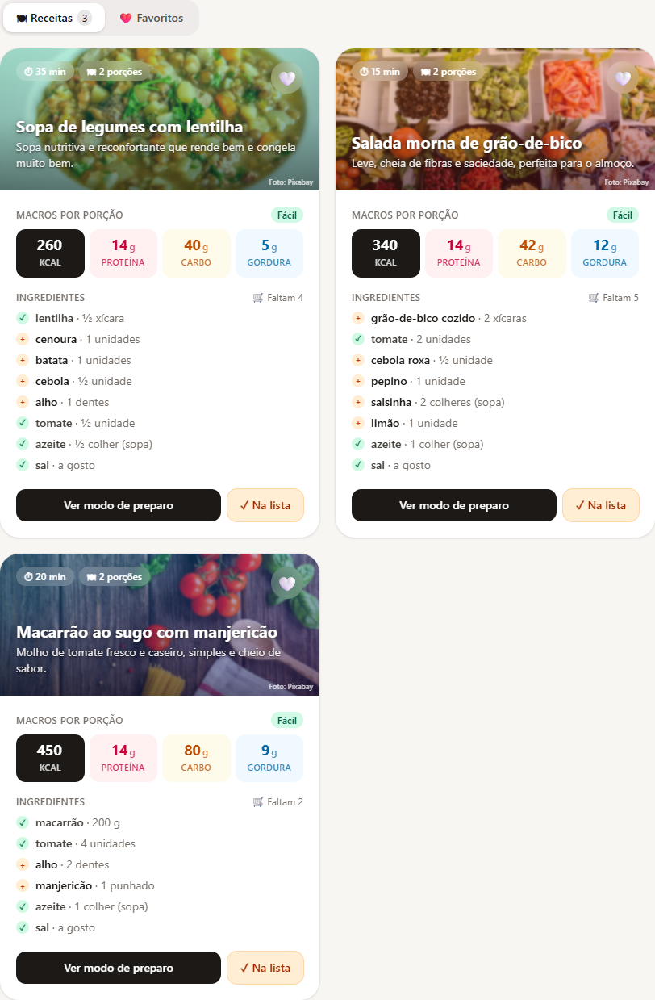
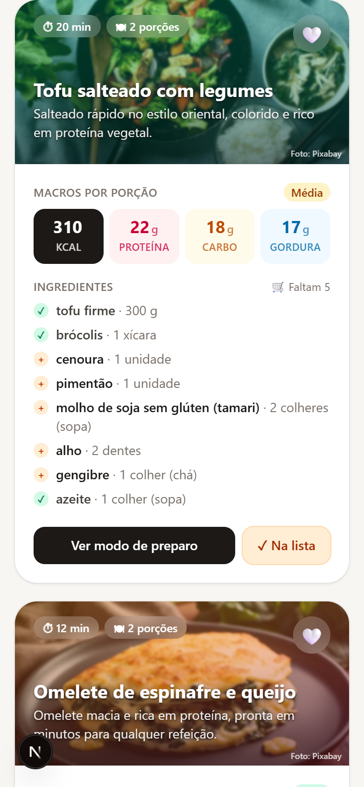

# 🍳 AI Recipe Generator

**Turn whatever is in your fridge into three personalized, macro-counted recipes in seconds.**

Most of us open the fridge, see a handful of random ingredients and end up ordering takeout. Recipe sites assume you'll go shopping first, and they rarely say whether a dish fits a fitness goal. **AI Recipe Generator** starts from what you *already have*: you list your ingredients, pick a goal (muscle gain, weight loss or balanced), a time limit and any dietary restrictions. The app then uses generative AI to create three recipes, with nutrition facts per serving, a photo of each dish and an automatic shopping list for anything that's missing.

The interface is in Brazilian Portuguese 🇧🇷.

---

## 🔗 Live demo

**👉 [ai-recipe-generator-calamo.vercel.app](https://ai-recipe-generator-calamo.vercel.app)**

> No sign-up needed. Add your ingredients, pick a goal and generate recipes.

---

## 📸 Screenshots

| Desktop | Mobile |
| --- | --- |
|  |  |

<!-- Add more images to docs/screenshots/ and reference them here, e.g.:
| Recipe details | Shopping list |
| --- | --- |
|  |  |
-->

---

## ✨ Features

- **🤖 AI recipe generation from your ingredients**: add ingredients as chips (Enter or comma) or tap common suggestions, and get 3 distinct recipes built around them.
- **🎯 Fitness-goal filters**: muscle gain, weight loss or balanced, plus max prep time, dietary restrictions (vegetarian, lactose-free, gluten-free) and number of servings.
- **📊 Macros per serving**: calories, protein, carbs and fat shown prominently on every card.
- **📷 Dish photos**: each card shows a photo of the dish behind the title, fetched server-side with caching and a smooth fade-in. If no photo is found, the card falls back to a gradient.
- **❤️ Favorites**: save recipes to the browser (`localStorage`). The app keeps working even if storage is blocked.
- **🛒 Shopping list**: missing ingredients from the selected recipes, de-duplicated, with checkboxes and one-click copy.
- **🧪 Demo mode**: with no API key, the app serves curated sample recipes that still respect your filters and scale to the number of servings.
- **📱 Responsive and accessible**: mobile-first layout, ARIA states, keyboard support and reduced-motion support.

---

## 🛠 Tech stack

| Area | Technology |
| --- | --- |
| Framework | **Next.js 16** (App Router, Route Handlers) |
| UI | **React 19**, **Tailwind CSS 4** |
| Language | **JavaScript** (ES modules) |
| AI | **Google Gemini API** (free tier) or **Anthropic Claude API**, with structured JSON output |
| Images | **Pixabay API**, with **TheMealDB** as a fallback |
| Hosting | **Vercel** |

---

## 🚀 Running locally

**Prerequisites:** [Node.js](https://nodejs.org/) 20 or newer.

```bash
# 1. Clone the repository
git clone https://github.com/CalamoAndret/ai-recipe-generator.git
cd ai-recipe-generator

# 2. Install dependencies
npm install

# 3. Create your environment file from the template
cp .env.example .env.local      # Windows (PowerShell): Copy-Item .env.example .env.local

# 4. Start the dev server
npm run dev
```

Open **http://localhost:3000**.

### Environment variables

All variables are optional. With no AI key, the app runs in demo mode.

| Variable | Description |
| --- | --- |
| `GEMINI_API_KEY` | Google Gemini key. Free at [aistudio.google.com/apikey](https://aistudio.google.com/apikey). |
| `GEMINI_MODEL` | Gemini model. Default: `gemini-3.8-flash`. |
| `ANTHROPIC_API_KEY` | Anthropic Claude key (paid), from [console.anthropic.com](https://console.anthropic.com/). |
| `ANTHROPIC_MODEL` | Claude model. Default: `claude-opus-5-5`. |
| `ANTHROPIC_EFFORT` | `low`, `medium` or `high`. Default: `medium`. |
| `AI_PROVIDER` | `gemini` or `anthropic`. If empty, the first provider with a key is used (Gemini first). |
| `PIXABAY_API_KEY` | Pixabay key for dish photos. Free at [pixabay.com/api/docs](https://pixabay.com/api/docs/). Without it, TheMealDB is used. |

`.env.local` is git-ignored. API keys are only read on the server and never reach the browser.

---

## ⚙️ How it works

```
Browser ──POST /api/receitas──▶ Route Handler (server) ──▶ Gemini or Claude
   │                                │  1. sanitizes the input
   │                                │  2. requests JSON that follows a strict schema
   │                                │  3. validates and normalizes the response
   │◀──────── 3 clean recipes ──────┘
   │
   └──GET /api/imagem?q=…──▶ Route Handler ──▶ Pixabay → TheMealDB (fallback)
                                 └─ in-memory cache per search term
```

- **Server-side AI calls.** The browser never talks to the AI provider. A Next.js Route Handler holds the API keys, builds the prompt and picks the provider from the environment variables.
- **Structured output.** The model receives a JSON Schema (recipe name, time, difficulty, servings, macros, ingredients with an "already have it" flag, steps, a chef's tip and an English image search term). Its response must follow that schema.
- **Validation layer.** Every response goes through a normalizer that coerces types, clamps values, drops incomplete recipes and re-checks which ingredients the user already has. The UI never receives malformed data. Timeouts, rate limits, invalid keys and refusals are each turned into a friendly message.
- **Photos with caching.** Each card asks `/api/imagem` for a photo, and the 3 cards load theirs in parallel. The server queries Pixabay, falls back to TheMealDB, and caches results per term in memory, so concurrent requests for the same term share one lookup. Image failures never break the page.

### Project structure

```
app/
  api/receitas/route.js   # Recipe generation endpoint
  api/imagem/route.js     # Dish photo endpoint (Pixabay → TheMealDB, cached)
  page.js, layout.js      # UI and metadata
components/               # Ingredient input, filters, recipe card, shopping list
lib/
  ia/                     # AI providers (Gemini, Claude), shared prompt and schema
  normalizar.js           # JSON extraction, validation and normalization
  demo.js                 # Demo-mode sample recipes
```

---

## 👤 Author

**Cálamo Andret**

- 💼 LinkedIn: [linkedin.com/in/cálamo-andret](https://www.linkedin.com/in/c%C3%A1lamo-andret-377481238/)
- 💻 GitHub: [github.com/CalamoAndret](https://github.com/CalamoAndret)
- 🌐 Portfolio: [calamoandret.github.io/developer-portfolio](https://calamoandret.github.io/developer-portfolio/)

If you liked this project, feel free to ⭐ the repo or reach out on LinkedIn!

---

<sub>Nutrition values are AI-generated estimates and not medical advice.</sub>
